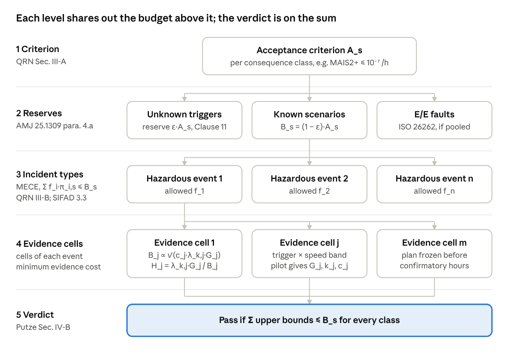

# Splitting the SOTIF risk budget: methodology

*2026-10-27 · David Feldmann. Also available as `08-risk-budget-split.pdf`; the live version is a Claude Doc.*

Split the acceptance criterion top-down: one budget per consequence class, minus reserves, shared over mutually exclusive incident types, then over evidence cells by minimum total evidence cost, B_j ∝ √(c_j·λ_k,j·G_j). The pass/fail verdict is on the sum of upper bounds, not on each share.

## The constraint that fixes the split

For each consequence class s, the frequencies that all incident types contribute to s must add up to no more than that class's acceptance criterion. Everything else about the split is a choice you have to justify.

$$\sum_i f_i\,\pi_{i,s} + R_{\text{reserve},s} \le A_s \quad \text{for every consequence class } s$$

Here f_i is the allowed frequency of incident type i and π_i,s is the fraction of its outcomes that land in class s. The Quantitative Risk Norm states this condition directly: the budget on each incident type "must be such that the total allowed frequency is fulfilled for all ν" ([Warg et al. 2020](https://www.es.mdh.se/pdf_publications/5963.pdf), Sec. III-B). The Safety Integrity Framework for Automated Driving (SIFAD) notes that ISO 21448 asks for this breakdown of the vehicle-level criterion but does not say how to do it ([Werling et al. 2025](https://arxiv.org/abs/2503.20544), Sec. 1.2.2).

The sum is a union bound. [Putze et al. (2023)](https://arxiv.org/abs/2304.10170), Sec. IV-B, apply the Bonferroni inequality over (harm, hazardous behaviour, triggering condition) triples. Each summand then needs its own upper bound, so "it is not sufficient to derive a single validation target".

## Budget tree

Levels 1–3 set the safety goals. Level 4 sets the validation targets. Only level 5 decides pass or fail.

## Method

Seven steps take the budget from the acceptance criterion down to hours per evidence cell. Steps 1–4 follow the literature directly. Steps 5–7 are this course's derivation, built on standard optimal-allocation results.

1. **Set one acceptance criterion per consequence class.** Use injury levels or Δv bands, each with a maximum frequency per hour ([Warg et al. 2020](https://www.es.mdh.se/pdf_publications/5963.pdf), Sec. III-A; [Werling et al. 2025](https://arxiv.org/abs/2503.20544), Sec. 2).
2. **Take the reserves off the top.** Keep a share for triggering conditions not in the taxonomy (ISO 21448:2022, Clause 11; 10 % in the example). Keep another share for ISO 26262 E/E faults if both draw on one vehicle-level criterion. Aviation does the same: about 10 % of the accident rate goes to systems, spread over about 100 failure conditions, which gives 10⁻⁹ per condition ([AMJ 25.1309](https://www.fzt.haw-hamburg.de/pers/Scholz/vorschriften/AMJ-25.html), para. 4.a).
3. **Define incident types that are mutually exclusive and collectively exhaustive (MECE).** Each type gets one safety goal. Record its fractions π_i,s across the consequence classes ([Warg et al. 2020](https://www.es.mdh.se/pdf_publications/5963.pdf), Sec. III-B). In your HARA, the incident types are the 160 hazardous events, grouped by harm class.
4. **Give each incident type a provisional share.** Start equal or from expert judgement, and treat the shares as movable ([Werling et al. 2025](https://arxiv.org/abs/2503.20544), Sec. 3.3, Remark 3.7).
5. **Estimate three numbers per evidence cell from a pilot.** These are the harm weight G_j, the bound factor λ_k,j = ½χ²_2(k_j+1)(C_b), and the cost per evidence hour c_j.
6. **Reallocate by minimum total evidence cost:** B_j ∝ √(c_j·λ_k,j·G_j) for one consequence class, or the convex program below for several. This replaces the provisional shares from step 4.
7. **Freeze the plan, collect fresh confirmatory evidence, and judge the sum.** The claim passes if Σ upper bounds ≤ budget for every class.

## Allocation rules compared

Use an equal or provisional split to plan safety goals. Use minimum evidence cost to plan validation targets: no other rule here uses the quantities that drive test effort.

| Rule | Share of budget | Source | Strength | Weakness |
| --- | --- | --- | --- | --- |
| Equal apportionment | B/n | [AMJ 25.1309](https://www.fzt.haw-hamburg.de/pers/Scholz/vorschriften/AMJ-25.html) para. 4.a; MIL-HDBK-338 ([summary](https://reliabilityanalytics.com/blog/?p=587)) | Simple, easy to audit | Ignores harm, exposure and difficulty |
| Weighted (AGREE, feasibility of objectives) | ∝ judged weight w_i | MIL-HDBK-338 ([summary](https://reliabilityanalytics.com/blog/?p=587)) | Puts more budget where failures are hard to prevent | Weights are expert ratings |
| Provisional, then shifted | Fraction of the RAC, moved between hazard scenarios as performance becomes known | [Werling et al. 2025](https://arxiv.org/abs/2503.20544), Sec. 3.3, Remark 3.7 | Matches how projects run | Shifting after seeing data breaks the confidence claim unless the evidence is fresh |
| Bonferroni sum, no fixed shares | Only Σ upper bounds ≤ A is required | [Putze et al. 2023](https://arxiv.org/abs/2304.10170), Sec. IV-B | Most flexible verdict | Gives no test plan per cell |
| Minimum evidence cost | ∝ √(c_j·λ_k,j·G_j) | Own derivation; same structure as cost-optimal stratified sampling, n_h ∝ N_h S_h/√c_h (Cochran 1977; Valliant et al. 2018, ch. 3, [Eq. 3.14](https://bookdown.org/content/78e0de27-f084-46fb-be7c-c77a199d2abf/stratification.html)) | Fewest total test hours, or lowest total cost | Needs pilot estimates of G_j, k_j and c_j |

## Minimum-effort formula

In cell j, a hazardous-behaviour rate r_j produces risk B_j = r_j·G_j. Bounding r_j at confidence C_b takes H_j = λ_k,j / r_j hours, which cost c_j each. For one consequence class, minimise the total cost under the budget:

$$\min_{B_j>0} \sum_j \frac{c_j\,\lambda_{k,j}\,G_j}{B_j}\quad\text{s.t.}\quad \sum_j B_j = B \;\Longrightarrow\; B_j = B\,\frac{\sqrt{c_j\,\lambda_{k,j}\,G_j}}{\sum_i \sqrt{c_i\,\lambda_{k,i}\,G_i}},\qquad \text{cost}^* = \frac{\big(\sum_j \sqrt{c_j\,\lambda_{k,j}\,G_j}\big)^2}{B}$$

The Lagrange condition c_j·λ_k,j·G_j / B_j² = μ gives the square root. With c_j = 1 the cost is test hours, as in the course workbook.

When one cell feeds several consequence classes, with harm weights G_j,s, allocate the rates r_j directly:

$$\min_{r_j>0} \sum_j \frac{c_j\,\lambda_{k,j}}{r_j}\quad\text{s.t.}\quad \sum_j r_j\,G_{j,s} \le B_s\ \ \forall s \;\Longrightarrow\; r_j = \sqrt{\frac{c_j\,\lambda_{k,j}}{\sum_s \mu_s\,G_{j,s}}}$$

The objective is convex and the constraints are linear, so any convex solver finds the optimum. Here μ_s is the shadow price of class s. A class with μ_s = 0 still has slack. With a single class, the program reduces to the square-root rule above.

## Worked example: unintended braking

The minimum-effort rule needs 564,084 replay hours, against 993,870 for an equal split. That is 43 % less evidence for the same Bonferroni claim. The data are the course workbook's synthetic values: 20 evidence cells (trigger context × speed band), A_H = 10⁻⁷ MAIS2+ per hour, a 10 % reserve, so B = 9·10⁻⁸ per hour, and C_b = 1 − 0.05/120.

| Rule | Total hours | Cost (clear road = 1, trigger routes = 3 per hour) | Budget share, clear-road cells |
| --- | --- | --- | --- |
| Equal split | 993,870 | 1,440,717 | 20.0 % |
| B_j ∝ √G_j (old course rule) | 567,814 | 1,173,648 | 51.6 % |
| B_j ∝ √(λ_k,j·G_j) | 564,084 | 1,136,781 | 49.2 % |
| B_j ∝ √(c_j·λ_k,j·G_j) | 607,705 | 1,061,226 | 35.9 % |

The cost weights are illustrative: driving targeted trigger routes is assumed to cost three times as much per hour as ordinary driving. Weighting by cost moves budget toward the expensive trigger cells, so each of their hours buys more. Total hours rise, but total cost falls by 7 % against the hours-optimal rule.

Splitting in proportion to the point estimate R̂_j fails outright here. Eleven of the 20 cells have k = 0, so R̂_j = 0, those cells get no budget, and the hours they need become infinite.

In the workbook (`tools/unintended_braking_risk_example.xlsx`), these figures sit in the `Validation Targets` sheet: columns G–I and M, total in I27, equal split in L27. The cost-weighted row is not in the workbook yet.

## Rules that keep the confidence claim valid

The split only plans the testing. The claim stays valid if these five rules hold.

- **Freeze before confirming.** Shares computed from pilot data (k_j, G_j) are fixed before the confirmatory hours start. Shifting shares between hazard scenarios ([Werling et al. 2025](https://arxiv.org/abs/2503.20544), Remark 3.7) is allowed between campaigns, never within one.
- **Split α as well as the risk.** With n simultaneous bounds, require Σ(1 − C_b) ≤ 1 − C. An equal Bonferroni split is the default ([Putze et al. 2023](https://arxiv.org/abs/2304.10170), Sec. IV-B). For a joint claim from two separate tests, ISO 21448:2022 C.6.3.3 (p. 156) gives the confidence as 1 − (α₁ + α₂).
- **Judge the sum, not each share.** Passing means Σ upper bounds ≤ B for every class. Slack in one cell absorbs an overrun in another, as long as the sum holds.
- **Keep the reserves.** The reserve for unknown triggers is covered by field hours in which every hazardous behaviour maps to a known trigger; any unexplained one counts against the reserve (ISO 21448:2022, Clause 11).
- **Re-run after every change.** Changing the ODD, the taxonomy or the software changes G_j and k_j, so the allocation is computed again.

## Related approaches

**Hierarchy of acceptance criteria (Hofmeister & Kinalzyk, AVL).** The global criterion is broken into hazard-based criteria, and those into scenario-class criteria. The linked scenario-class criteria must add up to their hazard-based criterion, and the hazard-based criteria to the global one. One scenario class can belong to several hazards, and each scenario class gets exactly one validation target. This is the same structure as the method above, stated in process terms. Two points to take over:

- **Behavioural criteria next to the statistical ones**, e.g. "keep 1.5 m to cyclists". They become pass/fail criteria of each test case; the statistical criteria set hours and runs.
- **Two reasons for splitting:** to avoid concentrating residual risk in parts of the ODD, and to plan testing. Too many scenario classes make each budget so small that testing becomes infeasible, which the square-root rule quantifies.

**Evidence per triggering condition (Patel & Jung 2026).** A performance target shown under one condition (clear weather, near range) is evidence under another (rain, far range) only after a test under that condition. Evidence must count *independent* units: recorded sequences or separate drives, not frames or correlated minutes. The minimum per condition is the zero-failure bound

$$n_j \ge \frac{-\ln(1-\alpha)}{R_{HB,i,j}} \approx \frac{3}{R_{HB,i,j}} \quad (\alpha = 95\,\%)$$

in independent units, computed before recording. When the target is shown not to hold, the measures are a condition-specific threshold, an ODD restriction, a mitigation downstream, or a **reallocation of the budget at vehicle level**. In the split above, this means each trigger context j in R_HB,i = Σ_j ν_j R_HB,i,j needs its own independent evidence.

## Sources

- Warg, F. et al. (2020). [The Quantitative Risk Norm – A Proposed Tailoring of HARA for ADS](https://www.es.mdh.se/pdf_publications/5963.pdf). DSN Workshops. Sec. III-A (consequence classes), III-B (incident types, MECE, budget condition).
- Werling, M., Faller, R., Betz, W., Straub, D. (2025). [Safety integrity framework for automated driving](https://arxiv.org/abs/2503.20544). arXiv:2503.20544. Sec. 1.2.2, 3.3 (Remark 3.7, Example 3.3), 4.1.
- Putze, L. et al. (2023). [On Quantification for SOTIF Validation of Automated Driving Systems](https://arxiv.org/abs/2304.10170). arXiv:2304.10170. Sec. IV-A, IV-B.
- JAA [AMJ 25.1309](https://www.fzt.haw-hamburg.de/pers/Scholz/vorschriften/AMJ-25.html), para. 4.a (derivation of 10⁻⁹ per failure condition); current FAA text: AC 25.1309-1B (2024), Sec. 3.2.4.1.
- MIL-HDBK-338, *Electronic Reliability Design Handbook* (equal, AGREE, feasibility-of-objectives, minimum-effort apportionment); summary at [Reliability Analytics](https://reliabilityanalytics.com/blog/?p=587).
- Cochran, W. G. (1977). *Sampling Techniques*, 3rd ed. Wiley (optimum allocation with cost). Valliant, R., Dever, J., Kreuter, F. (2018). *Practical Tools for Designing and Weighting Survey Samples*, 2nd ed., ch. 3 ([Eq. 3.14 restated](https://bookdown.org/content/78e0de27-f084-46fb-be7c-c77a199d2abf/stratification.html)).
- ISO 21448:2022(E), Clause 11; Annex C.6.3.3, p. 156.
- Hofmeister, J., Kinalzyk, D. (AVL Software and Functions). *Acceptance Criteria, Validation Targets and Performance Targets in an ISO 21448 conform development process*. Thematic paper, ca. 2023. Sec. 2.2 (breakdown), Sec. 3 (validation targets), Sec. 4 (performance targets).
- Patel, M., Jung, R. (2026). [Uncertainty Evaluation to Support SOTIF Analysis for Determining the Applicability of Performance Targets Across Triggering Conditions in ML-Based LiDAR Object Detection](https://arxiv.org/abs/2610.35092). arXiv:2610.35092. Sec. 3.5 (Eq. 5), Sec. 6.1 (Table 5).

Locations for Cochran (1977) and MIL-HDBK-338 are given by chapter topic only; their section numbers were not checked.
